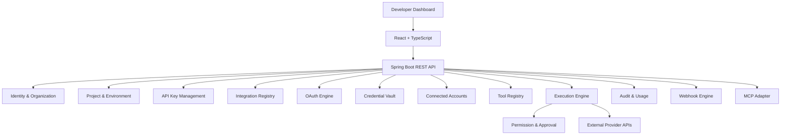

# System Architecture

## Architectural style
Start with a modular monolith. Keep identity, tenancy, projects, API keys, integrations, OAuth, credentials, connections, tools, execution, approvals, webhooks, usage, billing, and MCP behind module boundaries. Extract services only when operational scale justifies it.

## High-level flow

## Module dependency direction
- Web/controllers depend on application services.
- Application services depend on domain interfaces.
- Persistence adapters implement repository interfaces.
- Connector adapters implement the connector contract.
- Connector code does not bypass authorization, approval, or credential-resolution services.
- MCP and REST share the same execution application service.

## Tenant hierarchy
`Platform User -> Organization -> Project -> End User -> Connected Account -> Integration`.

All reads and writes must derive organization/project scope from authenticated server-side context. Never authorize from a client-supplied project ID alone.

## Runtime
PostgreSQL is the only mandatory local infrastructure service in the initial baseline. Redis can later support distributed rate limiting/cache; RabbitMQ can support asynchronous execution. Neither is required until its feature is implemented.
