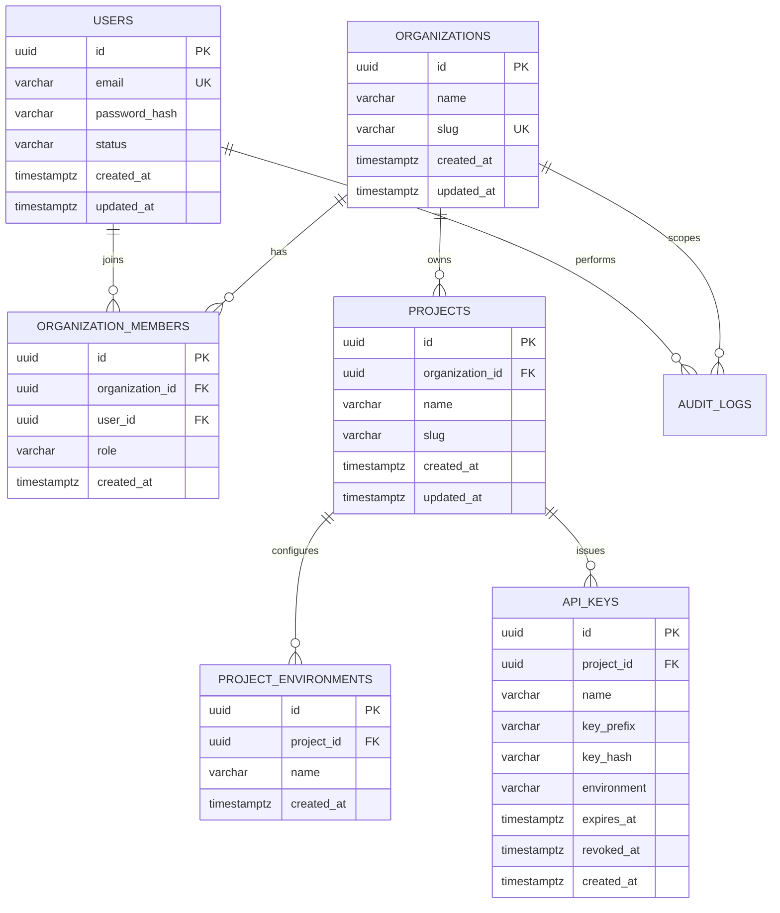

# Database Design

The initial Flyway migration creates the Milestone 1 foundation. Additional entities are intentionally deferred until their owning workflows are implemented.

## Initial ERD

## Security notes
- API keys store a one-way hash; raw secrets should be displayed once only.
- Provider access/refresh tokens must be encrypted with authenticated encryption and a key kept outside the database.
- Use explicit tenant predicates in repository queries and test cross-tenant denial.
